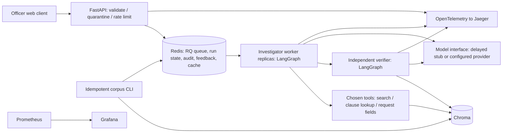

# Architecture and engineering decisions

Each box with executable behaviour is a Compose service boundary except the tools, which
run within the investigator process. Redis and Chroma have distinct durable volumes.

The investigator has its own LangGraph state, tool selection loop, memory of passages,
loop budget and responsibility to propose a position. The verifier is an independently
deployed service with its own LangGraph, evidence-resolution tool and semantic judgement.
Its handoff contract carries the candidate, evidence, request, prompt version and deadline.
This is not two prompts called in a single process. The verifier re-resolves supplied
passages from Chroma and rejects provenance mismatch before calling its judge.

The investigator graph is decide -> selected tool -> decide, or decide -> verifier.
Rejection feeds a focused retry query back into the investigator. At most two candidate
verification attempts occur. Unsupported recommendations never reach the caller.
If a verifier, model or tool fails, the worker returns a human-referral envelope with no
tariff position. If the worker itself is killed, polling reconciles an overdue run to failed.
The service does not automatically replay uncertain paid provider calls after a worker loss.

RQ decouples ingestion from execution and allows worker replicas to consume one durable
queue. The API returns 202 and a UUID, then the browser polls. Polling is justified because
an officer is interactively waiting and callbacks would introduce caller endpoint secrets,
delivery retries and an extra external contract. End-to-end timing begins at submission.

Deployment boundaries:

| Service | Reason |
|---|---|
| API/web client | Fast validation and polling must remain available while agents wait on models. |
| Investigator workers | Each process handles one run; replicas scale independent investigations. RQ work horses bound failure to one run. |
| Verifier | Independent release, failure isolation and explicit evidence handoff. Async provider calls avoid serialising all judges. |
| Redis | Durable queue/state and atomic rate limits, breaker state and idempotency. |
| Chroma | Retrieval memory/CPU and storage profile differs from API. |
| Corpus initializer | Batch ingestion is idempotent, one-shot and restartable; does not block every submission. |
| Model stub | Fixed delay isolates service performance from provider quotas. No shared Python sleep in the API. |
| Monitoring | Prometheus, Grafana, Jaeger, cAdvisor and Redis exporter observe separate failure domains. |

The initial implementation uses local embeddings only. Demo hash vectors are deterministic
lexical fixtures. Production requires sentence-transformers and an explicit model/revision.
PDF text splits at numbered clause boundaries, then LangChain's recursive splitter uses
1100 characters with 150 overlap, never crossing a page. Metadata retains document version,
hash, page, clause (or explicit page fallback), effective dates and source URL. Real tariff
schedule headings without a numbered clause need reviewer annotation for best clause-level
citations; page fallbacks are transparent, not fabricated clause identifiers.

Vector and lexical rankings use reciprocal-rank fusion. A LangChain Runnable orchestrates
retrieval, but is invoked only as the result of an agent decision. Additional searches for
mixed/changed-use provisions address the manual's structural retrieval trap. Context overlap
alone is insufficient, which is why the verifier checks provenance and semantic support.

Index collection names include manifest, chunker and embedding configuration fingerprints.
Stable chunk IDs allow unchanged chunks to be skipped, stale chunks removed and selected
collections re-embedded without deleting other collections. Switching to a different
embedding configuration creates a new collection and atomically changes the active pointer
only when ingestion succeeds. Content hashes must be updated in a reviewed official manifest.

Whole-run caching is keyed by the validated facts, client, corpus fingerprint, prompt version,
model and embedding identity; only independently verified results are cached. The cache's
source run remains auditable. Injection/validation checks and rate limits run before cache
lookup. Reindexing or changing prompt/model identity prevents reuse of stale results.

All provider calls have timeouts, bounded exponential-backoff retries and shared Redis
breaker state. After the breaker cools down only one half-open probe is allowed. Model
failures and verification failures have different audit events. Every model response is
costed before parsing, including malformed drafts. Provider failures lacking usage are
recorded as unknown cost. Tool calls have bounded wall time and underlying Chroma HTTP
timeouts; failed tools safely escalate. There is no fallback that fabricates a tariff position.

The official overlay runs local Ollama semantic embeddings, with optional local generation.
The measured final profile uses hosted Gemini generation. The local bootstrap validates
configured model revisions. Native Ollama constrained JSON permits only
known action shapes and retrieved citation identifiers. Citation metadata and the final
position are materialised from retrieved records and the model's claims. In production,
hosted models also select passage IDs: the server supplies exact full-passage quotes and
canonical metadata. The model is not asked to retype source quotations. The semantic
verifier still decides whether those claims are supported; constrained syntax is not
evidence of correct reasoning. Repeated identical tools are rejected with feedback and
still consume the bounded budget. Unverified model escalation prose stays in the audit,
while the public fallback states that an officer must review the evidence.

Observability uses low-cardinality metric labels, UUID correlation IDs, propagated W3C
trace context and structured JSON audit events. Audit records retain prompt versions/hash,
prompts, completions, exact queries/passages, timing and costs. These contain complaint
data and should receive retention/access policy before real consumers use the service.
Internal services remain unexposed on the Compose network. Public endpoints bind loopback;
configured client keys protect run ownership. This is a local course deployment, not a
multi-tenant internet deployment.

The container entrypoint prepares only its mounted data/output directories as root, then
drops to UID/GID 10001 before running any service command. This also handles a fresh Linux
clone where Docker creates root-owned bind-mount directories; the app itself runs unprivileged.

Redis and all containers are observed through dedicated exporters; Grafana/Jaeger expose
their native metrics. Chroma 1.5.9 does not expose a Prometheus application endpoint in this
configuration, so its resource/liveness coverage comes from cAdvisor and API readiness,
not a fabricated Chroma request metric. The one-shot initializer publishes its persisted
ingestion measurements through API metrics after exiting. Extending native Chroma query
metrics is a remaining observability improvement.

Rejected alternatives: a single embedding search misses modifiers; a synchronous API ties
up submission capacity; an automatic bill calculator exceeds scope; claiming regex filters
provide complete injection resistance would be misleading. Regex input/output screening is
a transparent baseline combined with restricted tool allowlists, untrusted-data prompts,
independent verification and human escalation. Adversarial coverage remains limited.
